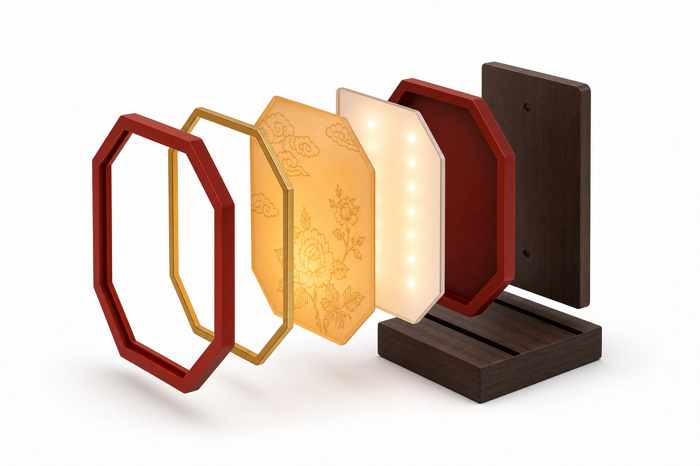

# 从宫灯元素到照明书立

[返回项目](./README.md)

## 1. 转译任务

现代产品转译需要决定哪些传统特征值得保留、它们如何进入产品功能，以及哪些装饰应被简化。项目选择照明书立作为阶段性概念，将桌面支撑、发光面板与宫灯的框架、灯面和暖光语言建立联系。

这是一组产品概念与使用情境表达，重点展示设计判断。训练实验为理解元素、观察生成可控性提供研究材料；现有记录未完整确认每张概念图与具体 LoRA 输出的直接关系。

## 2. 元素与产品构成的对应

| 传统视觉元素 | 转译后的表达 | 在概念中的作用 |
| --- | --- | --- |
| 六角或八角灯体轮廓 | 八角形侧板与框架 | 保留识别特征，并组织书立两侧视觉 |
| 木质骨架与竖向边框 | 侧板框架与深色底座 | 表达结构层级、稳定感与材质对比 |
| 半透明灯面 | 透光面板 | 为纹样、发光与表面层次提供载体 |
| 祥云与花卉纹样 | 面板装饰 | 将文化语汇融入主体表面 |
| 红金与暖黄色光感 | 框架、收边与发光氛围 | 建立传统特征与桌面场景的联系 |
| 底部收束结构 | 书立底座与面板支撑 | 组织产品落地关系与形态完整性 |

项目另保留了[12 条现代设计转译表](./data/design-translation.csv)，涵盖书立、桌面摆件与氛围灯等方向。本阶段展示围绕照明书立展开。

## 3. 正视概念：整体关系

正视图用来检查左右支撑体、书籍与发光面板之间的整体秩序。它呈现了八角轮廓、底座比例和纹样位置，但不能代替承重与防倾倒验证。

## 4. 四分之三视角：厚度与层次

斜视图补充框架厚度、底座关系、书籍与面板的空间位置，帮助从平面图案走向产品体量表达。不同概念图仍需在后续三维建模中统一尺寸与构造。

## 5. 夜间场景：照明与陈设

夜间场景将研究中的暖色光感放回桌面环境，表达阅读空间中的氛围价值。后续需验证亮度、眩光、色温与实际使用需求；现有图像不作为照明性能测试结果。

## 6. 分层结构：从表面到构成

分层表达区分外框、装饰收边、纹样面板、发光层、背板和底座，帮助解释产品构想。图中的光源、板件与连接方式属于构成示意，尚未形成经过电气、散热与装配验证的工程方案。

## 7. 整理成果与评价

原项目归档包含正视、四分之三视角、夜间光效、结构拆解，以及三视图尺寸草案、转译流程图和阶段自评表。

这些材料分别回答“是什么”“如何使用”“由什么组成”“如何从元素走到概念”。项目自评用于组织思考，不能替代外部用户研究或市场验证。

## 8. 后续设计问题

- 将四组概念表达统一到一个三维模型与尺寸系统。
- 验证书籍支撑、重心、摩擦、防倾倒和面板保护。
- 确定光源位置、控制方式、供电与散热方案。
- 比较纹样密度、透光材料与真实灯光下的视觉效果。
- 通过样机与使用观察进一步判断产品方向。
