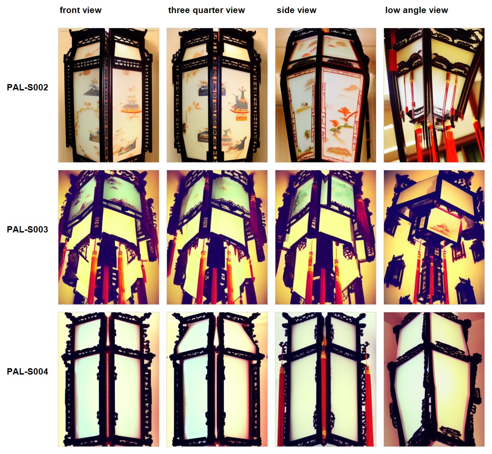
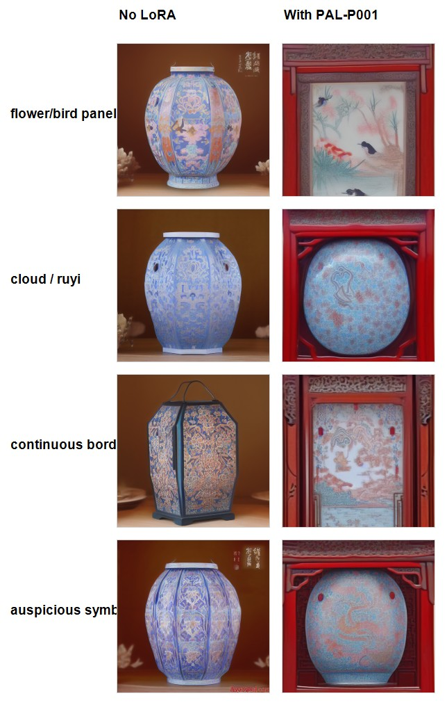

# 六轮 LoRA 实验：问题、调整与阶段判断

[返回项目](./README.md) · [数据准备](./DATA_PIPELINE.md)

## 1. 实验目标与技术范围

项目在 Stable Diffusion 1.5 基础模型上进行小规模 LoRA 实验，结合本地生成流程观察结构与图案的学习情况。现有运行摘要记载使用 CPU，环境当时未能使用 CUDA。

实验以视觉研究为目标：既观察是否更接近宫灯对象，也检查视角响应、部件关系和图案边界。它尚未形成经过多种子统计、盲评或独立测试集验证的量化基准。

## 2. S001：建立首轮结构实验

**输入与目标。** 使用 12 组图片和 caption，验证模型能否在既有基础模型上学习宫灯的结构与氛围。阶段报告记载 3 epochs、360 步，并保留对应模型与生成记录。

**观察。** 生成结果呈现宫灯悬挂与暖光特征，但平视要求经常被仰角倾向覆盖。

**下一轮调整。** 将视角纳入数据筛选，增加正面、斜视与侧面资料，并保留 S001 作为早期参考。

## 3. S002：从资料分布入手调整视角

**数据变化。** 实际训练目录为 15 组图文配对。记录为正面 6、四分之三 5、侧面 2、仰角 2；其中 13 张重新选自 S001 候选库，另补充 2 张资料。

**观察。** 阶段分析认为对象轮廓与灯面关系更易读；与此同时，顶部、底部与悬挂等部件表达不足，结果有趋于灯面或外壳符号的倾向。

**下一轮调整。** 不能仅增加相似的完整灯体照片，需将三维部件与制作关系明确纳入训练对象。

## 4. S003：补充结构语义与局部资料

**数据变化。** 28 组配对覆盖完整三维宫灯 6、斜视结构 6、侧面结构 4、局部结构 7、制作过程或裸骨架 3、结构示意 2。

**标注变化。** 更明确地描述 top cap、vertical posts、side panels、bottom frame、suspension point 等部件。

**训练与测试记录。** 摘要记载 3 epochs、840 步；基础无 LoRA / 有 LoRA 对照使用 seed 2026080803、12 steps、euler_a、CFG 7、384×512。

**观察。** 对照中宫灯本体与部件语言更明显，但四视角测试显示正面、斜视和侧面提示仍容易收敛到仰视、悬挂和强透视结果。

**设计判断。** 将“部件丰富度”与“视角响应”拆开评价。样本数量增加与局部信息增加，不意味着整体可控性同步提高。

## 5. S004：收紧视角配比

**数据变化。** 20 组配对中，平视正面 6、平视四分之三 6、侧面 4、细节 2、仰角参考 2。平视正面与斜视合计 60%，仰角参考限制为 10%。

**训练产物。** 记录保留模型文件；摘要记载 3 epochs、600 步，运行日志包含保存权重与退出码 0。

**测试条件。** 四视角测试记录 seed 2026080813、12 steps、euler_a、CFG 7，关注正面、斜视、侧面与仰角提示。

**观察与取舍。** 阶段分析将 S004 作为后续结构方向的主模型候选，认为其相对 S003 的仰角回归有所缓和；同时，装饰、上下结构和悬挂细节简化。实际图片仍显示较强视角倾向，因此采用“阶段候选”表述，保留继续验证的空间。

S002、S003、S004 合并图的各版本生成参数仍需逐项与记录核对，不作为严格统一条件下的量化排名。

## 6. P001：独立学习图案后仍有造型泄漏

**目标。** 将宫灯表面纹样与结构学习分开，减少图案模型对物体造型的干扰。

**数据。** 20 组配对，包含吉祥符号 2、边饰 2、祥云如意 5、花鸟 5、彩绘灯面 6。caption 使用 surface pattern only、flat decorative motif、lantern panel ornament、no lantern body structure 等表达。

**训练记录。** 摘要记载 3 epochs、600 步，保留模型与输出。

**提示矩阵。** 花鸟灯面、祥云如意、连续边饰、吉祥符号四组提示各有无 LoRA 与 P001 输出。记录的共同生成条件为 seed 2026080806、12 steps、euler_a、CFG 7、512×512。

**观察。** 图案与装饰面板语言增强，但红色木框、上沿与物体式构图反复出现。P001 因此保留为图案可行性实验，尚未达到可独立组合的纯纹样模块目标。

**下一轮调整。** 扩大元素分类、收紧局部裁切，检查边框与器形信息，并同步调整 caption。

## 7. P002：将数据边界落实到候选版本

**准备过程。** 以 22 类图案元素框架组织采集，保留批次裁切记录、修订记录、21 张候选和 22 张严格候选的多个版本。v3 记录明确面向 pattern-only。

**实际训练。** 核对实际 train 目录为 22 张图与 22 条 caption；运行日志显示 660/660 步并保存模型。部分摘要存在乱码，因此训练完成的判断采用文件、可读字段与运行日志交叉确认。

**当前结论。** 可以确认完成了更严格的数据准备与一轮训练。当前展示材料没有 P002 对应的生成对照，不能仅凭权重保存或 loss 宣称边框泄漏已经解决。

## 8. 跨实验的判断方法

| 评价问题 | 需要观察的内容 | 当前发现 |
| --- | --- | --- |
| 是否更接近宫灯对象？ | 灯体、面板、框架和悬挂关系 | 部分版本增强对象与部件语言 |
| 是否响应指定视角？ | 正面、斜视、侧面与仰角的区分 | 与结构丰富度之间仍有取舍 |
| 图案是否保持为表面语言？ | 是否附带边框、器形和灯体 | P001 仍存在造型泄漏 |
| 下一轮修改是否有依据？ | 资料分布、caption、测试与失败样例 | 已按问题调整数据和标注边界 |

## 9. 继续完善的实验

为 P002 补充无 LoRA / P001 / P002 对照；固定生成条件并增加多个种子；将对象识别、视角、部件和图案纯度分项记录；保留失败样例并核对训练配置快照。

这些改进将使后续判断从单次视觉观察逐步走向更完整的实验记录。
