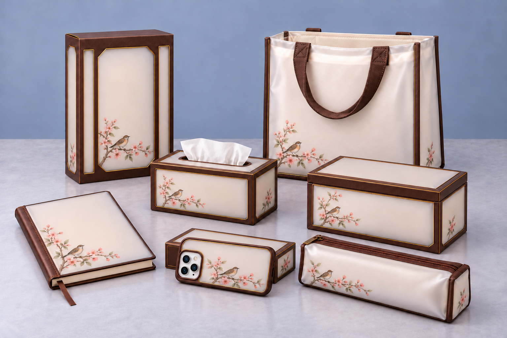
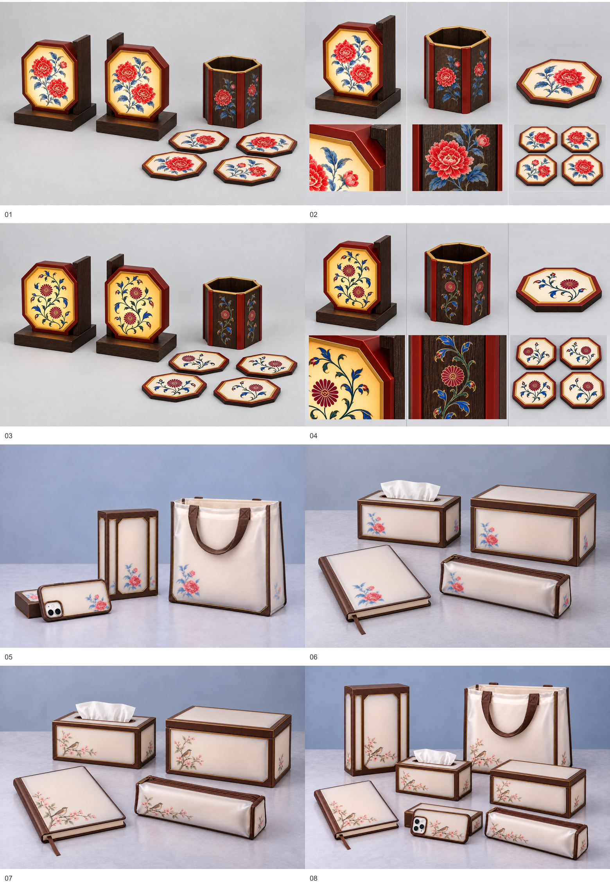

# 北京宫灯现代文创系列概念成果

更新日期：2026-10-20。

## 设计转译逻辑

将宫灯骨架转译为产品边框，将透光灯面转译为磨砂半透明外层，将灯面装饰转译为内层小幅纹样。保留现代产品使用形态，以少量图案和大面积留白组织系列视觉语言。

## 图片索引

以下图片与本说明放在同一目录。

| 文件 | 内容 |
| --- | --- |
| 00_current_products_overview.png | 八张当前展示图总览，编号顺序对应以下八项 |
| desktop_series_peony_application_v01.png | 牡丹款照明书立、笔筒、杯垫组合 |
| desktop_series_peony_details_v01.png | 牡丹桌面系列细节 |
| desktop_series_floral_scroll_application_v01.png | 卷草花卉款桌面系列 |
| desktop_series_floral_scroll_details_v01.png | 卷草花卉款细节 |
| modern_daily_layered_collection_v10_outer_rear_handle.png | 牡丹款手机壳、封闭包装盒、双层袋 |
| study_storage_layered_collection_v01.png | 牡丹款笔记本、笔袋、抽纸盒、收纳盒 |
| study_storage_bird_blossom_collection_v01.png | 海棠栖鸟款学习收纳四件组 |
| bird_blossom_full_collection_v02_corrected_box.png | 海棠栖鸟七类产品完整系列，已修正手机支撑盒 |

## 完整系列

## 当前成果总览

## 材料边界

产品图是由人工确定设计逻辑、筛选与修正，并借助通用生成式AI完成的概念表达，不是实物或工程图，不证明材料、尺寸、生产工艺或结构已经验证。纹样研究与产品概念生成分别记录，不能把这些产品图当作PAL-T001的训练输出。PAL-T001百步试验未达到预期产品风格学习效果，未继续投入训练。

本次发布只收录当前展示版本；绿色冰裂纹方案、支撑盒修正前版本、早期修改稿及合成训练候选保留在本地，不混入当前成果。
